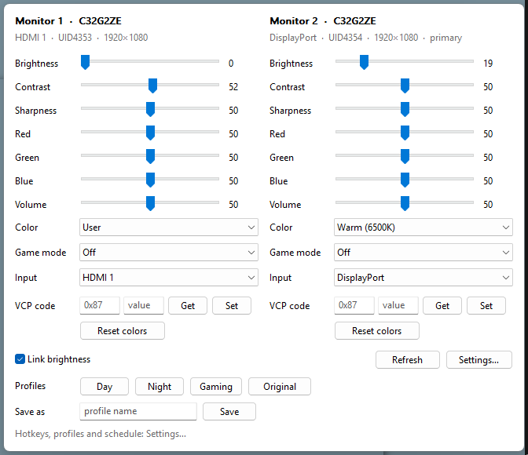

# Glint

Tiny native Windows tray app for DDC/CI monitor control. Rust + raw Win32, no Electron, no runtime.

- `glint.exe` – tray app, ~770 KB, ~2.4 MB private memory, 0% idle CPU
- `glintctl.exe` – command line companion

Built and tested on 2× AOC C32G2ZE (sold as 32G2WG8), works with any DDC/CI monitor.



## Install

1. Download `glint.exe` (and optionally `glintctl.exe`) from [Releases](https://github.com/andib0/glint/releases/latest).
2. Put it somewhere permanent, e.g. `%LOCALAPPDATA%\Programs\Glint\`, and run it. A sun icon appears in the tray.
3. Right-click the icon → **Start with Windows**.

DDC/CI must be enabled in the monitor's own OSD (it usually is by default). The exe is not code-signed, so SmartScreen may warn on first run ("More info" → "Run anyway").

## Features

- Panel (left-click tray): per monitor sliders for brightness, contrast, sharpness, red/green/blue gain, volume; dropdowns for colour preset, game mode, input. Only shows what each monitor actually answers.
- Raw VCP get/set for any code, "Reset colors" (VCP 0x08)
- Link brightness across monitors
- Profiles (Day / Night / Gaming / your own via "Save as"), exact restore including the hidden User RGB values
- Global hotkeys with on-screen display
- Time-of-day schedule
- Start with Windows, screens off, re-detect on plug/resume, single instance

Overdrive, Adaptive-Sync, Shadow Control and Low Blue are not exposed over DDC/CI by AOC – use the monitor OSD for those.

## Default hotkeys

| Keys | Action |
|---|---|
| Ctrl+Alt+PgUp / PgDn | Brightness ±10 (all monitors if linked, else the one under the cursor) |
| Ctrl+Alt+F1 / F2 / F3 | Profiles Day / Night / Gaming |
| Ctrl+Alt+M | Toggle panel |
| Ctrl+Alt+F12 | Screens off |

## Config

`%APPDATA%\Glint\config.toml` (tray → Edit config…, reloads automatically). Profiles, hotkeys, schedule:

```toml
[[profiles]]
name = "Reading"
all = { brightness = 30, color_preset = 5 }
monitors."2" = { brightness = 25 }      # "1" = leftmost, or "UID4353"

[[hotkeys]]
keys = "Win+Alt+R"
action = "profile:Reading"   # brightness_up, brightness_down, screens_off, toggle_panel

[[schedule]]
time = "21:00"
profile = "Night"
```

Log: `%APPDATA%\Glint\glint.log`. Capability cache: `caps.toml` (delete to re-read).

## CLI

```
glintctl list | dump [MON] | caps [MON]
glintctl get MON SETTING
glintctl set MON SETTING VALUE     # 40 | +10 | -10 | 0x11 | hdmi1 | srgb | warm
glintctl profiles | apply NAME | save NAME
```

MON: `all`, `1`, `2`, `UID4353`, `display1`.

## Build

Needs Rust (GNU toolchain is fine, no Visual Studio):

```
cargo build --release
cargo test                                              # 35 logic tests (mock monitors)
cargo test --test hardware -- --ignored --test-threads 1   # real monitors, restores values
```

Layout: `caps` (MCCS parser), `vcp` (feature catalog), `config`, `hotkey`, `schedule`, `profile`, `worker` (background DDC thread, coalesces slider writes), `cli`, `ddc_win` (dxva2), `ui/` (tray, panel, OSD).
